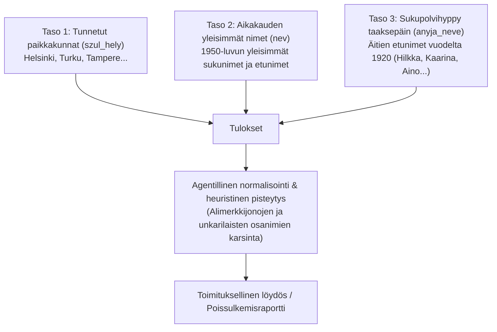

# Case-analyysi: Arkistoharavointi ja sukupolvihyppyvieraskielisissä aineistoissa

> **Menetelmäkuvaus agentilliseen datajournalismiin ja OSINT-tutkimukseen**  
> *Julkaistu osana Agentillinen Datajournalismi FI -verkoston avoimia menetelmiä.*  
> **Tietosuojahuomautus (Zero-PII):** Tämä dokumentti kuvaa ainoastaan tiedonhaun ja data-analyysin algoritmista menetelmää, hakutermien muodostamista ja arkistoarkkitehtuuria. Dokumentti **ei sisällä** arkistoista löydettyjen luonnollisten henkilöiden henkilötietoja, peitenimiä tai aktitunnuksia (GDPR & Tietosuojalaki 27 §).

---

## 1. Johdanto: Miksi "laiha löydös" on menetelmällinen menestys?

Tutkivassa journalismissa ja OSINT-tiedonhankinnassa törmätään usein tilanteeseen, jossa ulkomainen viranomainen julkaisee historiallisen arkistomassan (kymmeniä- tai satojatuhansia tietueita), joka on:
1. **Vieraskielinen** (esim. unkari, puola, tšekki, saksa).
2. **Käyttöliittymältään hidas tai puutteellinen** (ei suoria "kansalaisuus"-fasetointeja).
3. **Pirstaleinen** (nimiä on tallennettu eri aikakausina paperikorteilta, reikäkorteilta ja magneettinauhoilta vaihtelevilla kirjoitusasuilla).

Kun arkisto otetaan haltuun agentillisella tiedonhaulla, **negatiivinen tai niukka tulos on yhtä arvokas kuin laaja osumalista**:
* **Poissulkemisen arvo (*Proof of Absence*):** Systemaattinen läpikäynti tilastollisesti merkittävillä nimijoukoilla todentaa tieteellisesti, että kyseinen arkistoerä *ei* sisällä laajaa kohdemaahan kohdistuvaa materiaalia. Tämä säästää toimituksilta kuukausien turhan manuaalisen työn.
* **Arkistoprofiilin paljastaminen:** Osumien puuttuminen todistaa arkiston todellisen luonteen: esimerkiksi massiivisen tietokannan paljastuminen pelkäksi sisäisen valvonnan kortistoksi ulkomaantiedustelun sijaan.

---

## 2. Metodologia: Kolmitasoinen sukupolvihaku

Pelkkä valtion nimen (esim. *Finland*, *Finnország*) haku jättää usein 90 % osumista pimentoon, koska vanhoissa valvontakorteissa kansalaisuus- tai syntymämaakenttiä ei usein täytetty tai ne oli koodattu numeerisilla tunnuksilla.

Tämän vuoksi menetelmässä sovellettiin kolmitasoista agentillista hakustrategiaa:

### 2.1. Taso 1: Syntymäpaikkakohdennus (`szul_hely`)
Ensimmäinen taso testaa kohdemaan keskeiset kaupungit sekä niiden historialliset variantit:
* Esim. *Helsinki, Helsingfors, Turku, Åbo, Tampere, Oulu, Viipuri, Wiborg*.

### 2.2. Taso 2: Aikakauden yleisimmät suku- ja etunimet (`nev`)
Kylmän sodan aktiivisimmalla kaudella (1950–1980) toimineet henkilöt olivat useimmiten syntyneet 1920–1950-luvuilla.
* **Sukunimet:** 1950-luvun 50 yleisintä sukunimeä ja niiden foneettiset/skandittomat variantit (esim. *Virtanen, Korhonen, Mäkinen/Makinen, Nieminen, Hämäläinen/Hamalainen*).
* **Etunimet:** Aikakauden 50 yleisintä miehen ja naisen nimeä (esim. *Matti, Juhani, Kari, Eero, Pentti, Seppo, Pirkko, Ritva, Marjatta, Leena*).

### 2.3. Taso 3: Sukupolvihyppy taaksepäin (`anyja_neve`)
Tämä on menetelmän innovatiivisin vaihe. Itäblokin rekistereissä äidin tyttönimi ja etunimi (*anyja neve*) oli pakollinen tunnistekenttä homonyymien erottamiseksi.
* Koska kylmän sodan kontaktit syntyivät 1920–1940-luvuilla, heidän **äitinsä syntyivät ja saivat etunimensä 1910–1920-luvuilla**.
* Tässä haussa käytettiin väestötilastojen mukaista **vuoden 1920 suosituimpien tyttölasten nimien kantaa** (yli 70 nimeä ja niiden translitteraatioita).
* **Miksi tämä toimi?**
  * Kohdehenkilön oma sukunimi tai etunimi saattoi olla peitetty tai vääristynyt, mutta äidin tyttönimi (esim. *Hilkka*, *Kaarina*) säilyi kortissa usein alkuperäisenä.

---

## 3. Julkinen sanasto: Käytetyt 1920- ja 1950-lukujen tilastolliset hakusanat

Metodologisen toistettavuuden varmistamiseksi julkiseen käyttöön jaetaan tutkimuksessa sovelletut sanastot:

### A. Vuoden 1920 yleisimmät suomalaiset äitien etunimet (`anyja_neve`)
> *Aili, Aino, Annikki, Aniki, Aune, Eeva, Eila, Elina, Elsa, Esteri, Helmi, Helvi, Hilja, Hilkka, Hilka, Hilma, Impi, Irja, Kaarina, Karina, Kerttu, Kertu, Kirsti, Kyllikki, Lahja, Laina, Lempi, Liisa, Lyyli, Maija, Maire, Marjatta, Marjata, Martta, Mirjam, Orvokki, Rauha, Saimi, Salme, Siiri, Sirkka, Sirka, Suoma, Sylvi, Silvi, Taimi, Tellervo, Telervo, Terttu, Tilda, Toini, Tuulikki, Tulikki, Tuliki, Tyyne, Tyne, Tyyni, Tine, Valma, Vieno, Viola.*

### B. 1950-luvun yleisimmät sukunimet (perusmuodot + skandittomat)
> *Aalto, Ahonen, Anttila, Hakala, Halonen, Heikkinen, Heinonen, Hiltunen, Hamalainen/Hämäläinen, Jarvinen/Järvinen, Jokinen, Kallio, Karjalainen, Kettunen, Kinnunen, Karkkainen/Kärkkäinen, Koskinen, Laaksonen, Laine, Lehtinen, Lehtonen, Leppanen/Leppänen, Makela/Mäkelä, Makinen/Mäkinen, Manninen, Mattila, Moilanen, Mustonen, Niemi, Nieminen, Nurmi, Ojala, Peltonen, Pitkanen/Pitkänen, Rantanen, Rasanen/Räsänen, Saarinen, Salminen, Salonen, Savolainen, Suominen, Tiainen, Tuominen, Turunen, Vaananen/Väänänen, Virtanen.*

### C. 1950-luvun yleisimmät miesten ja naisten etunimet
> *Matti, Juhani, Kari, Markku, Pekka, Jukka, Heikki, Timo, Mika, Seppo, Pentti, Hannu, Jorma, Eero, Ilkka, Reijo, Pertti, Jouko, Ari, Jarmo, Antti, Harri, Arto, Esa, Erkki, Simo, Risto, Pauli, Olavi, Antero, Tapani, Kalervo, Kalevi, Veikko, Toivo, Ritva, Pirjo, Marjatta, Tuula, Raija, Leena, Seija, Sirkka, Kirsti, Tarja, Sinikka, Eila, Aila, Paula, Kaarina, Anneli, Eeva, Hilkka, Kerttu, Liisa, Maija.*

---

## 4. Haasteet ja agentillinen kohinanpoisto (False Positives)

Kansainvälisessä aineistossa pelkkä merkkijonohaku tuottaa vääriä positiivisia seuraavista syistä:
1. **Alimerkkijonot (*Substring Collisions*):**
   * Lyhyet suomalaiset nimet osuvat osaksi yleisiä unkarilaisia tai saksalaisia nimiä:
     * `Aune` ➔ unkarilainen *Czauner*
     * `Eila` ➔ *Weiland*
     * `Impi` ➔ *Olimpia*
     * `Irja` ➔ *Czirják*
     * `Sirka` ➔ *Zsirka*
2. **Monikansalliset kansainväliset nimet:**
   * Nimet kuten *Anna, Maria, Ilona, Ida, Karl, Hans, Berg, Horn* esiintyvät Keski-Euroopassa luonnostaan tuhansia kertoja.
3. **Agentillinen pisteytys:**
   * Kohinan hallitsemiseksi agentin on laskettava painotettu pisteytys:
     $$\text{Pisteet} = w_{\text{paikka}} \cdot S_{\text{paikka}} + w_{\text{aiti}} \cdot S_{\text{aiti}} + w_{\text{nimi}} \cdot S_{\text{nimi}} - w_{\text{kohina}} \cdot S_{\text{unkari}}$$
   * Vasta kun yhdistelmä sisältää harvinaisen suomalaisnimen + tunnetun maantieteellisen koordinaatin, tapaus nostetaan toimittajan tarkistusjonoon.

---

## 5. Eettinen tiedonkeruu ja palvelinhygienia (*Polite Scraping*)

Agentillisen tiedonkeruun ensisijainen sääntö julkisissa palveluissa on **palvelimen kuormituksen minimointi**:
* **Ei rinnakkaispurskeita:** Kyselyt ajetaan sarjamuotoisesti yhdellä säikeellä.
* **Kohtelias aikaviive:** Kyselyiden välissä pidetään vähintään **0.5–1.0 sekunnin viive**.
* **Idempotentti lokitus:** Kaikki suoritetut hakutermit tallennetaan välittömästi lokiin, jotta keskeytynyt ajo voidaan jatkaa ilman turhia uudelleenkyselyitä.
* **Zero-PII -julkaisu:** Julkisissa raporteissa jaetaan ainoastaan metodit ja sanastot – henkilötiedot suojataan.

---

## 6. Yhteenveto ja jatkohyödynnettävyys

Tämä case osoittaa, että agentillinen datajournalismi ei ole pelkkää olemassa olevien valmiiden taulukoiden visualisointia, vaan **aktiivista kokeellista tutkimusta**. 

Samaa sukupolvihyppyyn ja tilastollisiin väestönimistoihin perustuvaa strategiaa voidaan soveltaa mm.:
* Itä-Euroopan entisten turvallisuuspalveluiden digitoituihin arkistoihin (Stasi, KGB, Securitate).
* Kansainvälisiin yhtiö- ja kaupparekistereihin tilanteissa, joissa suomalaisomistukset on kätketty ulkomaisiin holding-yhtiöihin.
* Historiallisiin siirtolaisuus- ja merenkulkurekistereihin.
