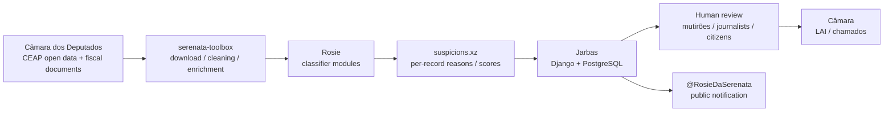

# Operação Serenata de Amor: a primary-source audit of Rosie, Jarbas and the civic-technology stack

## Executive summary

Operação Serenata de Amor was an open-source Brazilian civic-technology project built to scrutinise reimbursements made under the **Cota para o Exercício da Atividade Parlamentar (CEAP)** of Brazil’s Chamber of Deputies. Its public narrative often described **Rosie** as an “artificial intelligence”, but a code- and documentation-led reconstruction supports a narrower description: Rosie was principally a collection of specialised anomaly detectors and statutory/data-consistency checks, with a minority of genuinely statistical components. The best-documented machine-learning component was the meal-price outlier detector, described in academic analyses of the source as using unsupervised clustering; several other core checks were deterministic tests against legal limits, dates, registry status, identifiers or physically implausible travel. The available evidence does **not** support characterising Rosie as a general-purpose AI system, nor does it establish an implemented ensemble-learning system that fused every classifier into a single learned fraud score. citeturn713692view0turn236416search2turn492325search3

The project emerged from Irio Musskopf’s work in early 2016 according to the repository history, although the current Open Knowledge Brasil (OKBR) project page labels the project “2015–Atualmente”. Its first crowdfunding campaign ran on Catarse from **7 September to 7 November 2016**, raising **R$80,424.00 from 1,296 backers**, or **131% of the R$61,280.00 target**. Those figures are directly recorded by Catarse and are preferable to later rounded retellings saying merely “about R$80,000” or “30% above target”. citeturn240720view0turn702075search0turn702075search3

The project’s most important institutional contribution was not an automated finding of “corruption”, but an **accountability funnel**: public CEAP records were downloaded and enriched; Rosie generated suspicions; humans inspected them in *mutirões*; selected cases were sent to the Chamber; and only a subset resulted in reimbursements being returned. A contemporaneous project report states that a January 2017 review effort sent **629 cases concerning 216 deputies and R$378,844.05 in questioned reimbursements**. A later project report recorded **R$50,569.18 actually returned**, relating specifically to meal expenses, and stated that **134 federal deputies** had made returns. The current OKBR project page describes the same R$50,569.18 figure but changes the unit to “134 reimbursements cancelled”; this is a material wording discrepancy, so the contemporaneous “134 deputies” formulation is retained here. An independently reconstructed, transaction-level Chamber total matching the R$50,569.18 cumulative figure was not located. **Not verifiable from open primary sources.** citeturn100029search1turn100029search2turn100029search4turn702075search2

The project’s technical architecture was unusually transparent. CEAP data came from Chamber open-data files; `serenata-toolbox` handled data acquisition and preparation; Rosie produced suspicion records; **Jarbas** exposed reimbursement and supplier records for human inspection; and a **Whistleblower** component, later folded into Jarbas, selected untweeted suspicions for the `@RosieDaSerenata` account. Jarbas used Django/Gunicorn, PostgreSQL, Celery, RabbitMQ and an Elm/Node front end; importantly, its search implementation used PostgreSQL facilities rather than Elasticsearch. citeturn931348search9turn931348search14turn249150search0turn931348search2

As of **14 November 2026**, the historical repositories remain publicly available, but the core Serenata software is not under the cadence of an actively developed production platform. GitHub metadata for the merged main repository shows an update on **31 January 2024**; `serenata-toolbox` shows its latest indexed commit on **8 January 2020**; the standalone Rosie, Jarbas and Whistleblower repositories were archived in 2018 after their functionality moved elsewhere. The project’s own README explicitly says Rosie, Jarbas and infrastructure receive less frequent updates and directs contributors toward **Querido Diário**, the OKBR project that grew out of the same civic-data programme. The present live-operational state of `jarbas.serenata.ai` and current posting state of `@RosieDaSerenata` could not be independently confirmed from an open primary status endpoint on 14 November 2026. **Not verifiable from open primary sources.** citeturn136612search0turn136612search2turn931348search0turn931348search1turn931348search2turn240720view0turn875342search8

iturn933536image1

*Contemporary project artwork associated with the Data Science Brigade’s coverage of the operation. It is included as historical context, not as evidence for any quantitative claim.*

### Method and evidentiary assumptions

This report treats source code, Git history and repository documentation as controlling evidence for technical behaviour; Câmara dos Deputados, Planalto, Catarse and OKBR records as controlling evidence for institutional, legal and funding claims; and academic work as corroboration or interpretation. Project-authored Medium/Data Science Brigade posts are treated as **first-party retrospective sources**, but not as equivalent to Chamber transaction records. Media coverage is used only where it adds independently relevant context and is never counted as independent confirmation when it repeats project interviews. citeturn240720view0turn642997search0turn642997search4turn702075search0turn702075search2

The term **“primary source”** therefore has a qualified meaning for impact figures. A Serenata/OKBR report is primary evidence of what the project recorded, but it is not necessarily independent governmental verification of a refund. Wherever no Chamber-side transaction set or official response corpus could be reconstructed, this distinction is made explicit. No missing value has been estimated or interpolated.

Portuguese terminology is preserved where precision matters: *Cota para o Exercício da Atividade Parlamentar* (CEAP), *chamado* (a request/ticket sent to the Chamber), *mutirão* (a coordinated volunteer review sprint), *nota fiscal/comprovante* (invoice/receipt), and *ressarcimento/reembolso* (reimbursement). English translations are explanatory rather than substitutions for the statutory terms.

## Origin, governance, funding and statutory basis

The repository history says Irio Musskopf developed the main ideas in **early 2016** and that the first crowdfunding took place in **September 2016**. The present OKBR page, however, labels Serenata “2015–Atualmente”. Because neither source identifies a single incorporation or foundation instrument, the safest reconstruction is that 2015 is OKBR’s retrospective project-year label while the documented public technical project took shape in 2016. An exact legal “foundation date” before the September 2016 campaign is **Not verifiable from open primary sources.** citeturn240720view0turn702075search2

The project initially operated as a small, distributed technical group associated publicly with **Data Science Brigade**. OKBR’s current description says the initial team had **10 people**. The main repository’s historical README contains a separate internal inconsistency: it refers to a “group of eight” but lists nine long-term names — Tatiana Balachova, Felipe Cabral, Eduardo Cuducos, Irio Musskopf, Bruno Pazzim, Ana Schwendler, Jessica Temporal, Yasodara Córdova and Pedro Vilanova. This illustrates why head-count claims from retrospective summaries should not be silently harmonised. citeturn240720view0turn702075search2

### Crowdfunding record

| Metric | Primary record | Exact value | Period / as-of | Primary URL |
|---|---|---:|---|---|
| Campaign target | Catarse | **R$61,280.00** | Campaign 7 Sep–7 Nov 2016 | `https://www.catarse.com.br/serenata` |
| Amount raised | Catarse | **R$80,424.00** | Successful on 7 Nov 2016 | `https://www.catarse.com.br/serenata` |
| Target achieved | Catarse | **131%** | 7 Nov 2016 | `https://www.catarse.com.br/serenata` |
| Backers | Catarse | **1,296 people** | 7 Nov 2016 | `https://www.catarse.com.br/serenata` |
| Indicative net after fees/tax | Project Catarse update | **R$67,049.02**, explicitly described at the time as subject to final boleto reconciliation | Campaign update, 2016 | `https://www.catarse.com.br/serenata/updates` |
| Stated two-month team cost | Project Catarse update | **R$39,000.00** | 2016 campaign update | `https://www.catarse.com.br/serenata/updates` |
| Recurring Apoia.se display | Apoia.se | **R$683/month estimated; R$4,500/month goal; 20 supporters; 15.2%** | Page retrieved 14 Nov 2026; live values are mutable | `https://apoia.se/serenata` |

The first four values are directly visible on Catarse. A campaign update explained that the team expected to receive **R$67,049.02** after a stated **13% Catarse fee and 4% donation tax**, but warned that the amount still depended on final boleto payments; it also placed two months of team costs at **R$39,000** and reported **364 technical volunteers** at that point. These are campaign-period figures, not audited final accounts. citeturn702075search0turn702075search8

The recurring Apoia.se campaign is explicitly described as the second crowdfunding mechanism. Its page, retrieved on **14 November 2026**, displayed an estimated **R$683 per month**, a **R$4,500/month goal**, **20 supporters**, and **15.2% attainment**. Because Apoia.se values can change and no immutable dated financial statement was found for those exact current display values, they should be cited as a live-page snapshot rather than cumulative project finance. citeturn702075search1

Serenata was progressively institutionalised inside **Open Knowledge Brasil**. OKBR states that its **Ciência de Dados para Inovação Cívica** programme was created in **2018 in the context of Serenata de Amor**, and later became the institutional home for work including Querido Diário. The sources establish institutional integration by 2018, but they do not reveal a single legal transfer, board resolution or “handover date” from Data Science Brigade to OKBR. **Not verifiable from open primary sources.** citeturn875342search9turn875342search7

Directly evidenced post-launch support includes recurring crowdfunding and **DigitalOcean** infrastructure support. The repository says Jarbas historically ran on DigitalOcean droplets with Docker Cloud, and OKBR lists DigitalOcean as a partner. A complete, year-by-year ledger of grants specifically restricted to Serenata after institutionalisation was not found in the reviewed open primary material. **Not verifiable from open primary sources.** citeturn240720view0turn702075search2

### The legal basis: CEAP, LAI and LGPD

**Ato da Mesa nº 43, de 21 de maio de 2009** instituted the CEAP framework. Article 1 links reimbursable expenditure to parliamentary activity, while the act and its later consolidated versions define categories and ceilings. The Chamber’s current explanatory material also makes clear that CEAP covers multiple forms of expenditure and that unused monthly quota can accumulate during the financial year. citeturn642997search0turn642997search1turn642997search2

Primary URL: `https://www2.camara.leg.br/legin/int/atomes/2009/atodamesa-43-21-maio-2009-588364-publicacaooriginal-112820-cd-mesa.html`

**Lei nº 12.527/2011 — Lei de Acesso à Informação (LAI)** supplied the wider transparency and request framework. Its principles include publicity as the general rule, proactive disclosure, use of information technology and social control; Article 10 allows any interested person to submit an information request without having to justify the reason, while Article 11 sets the general response mechanism and statutory timing. This made it legally possible for citizens to move from open-data analysis to formal requests for clarification. citeturn642997search4turn642997search5

Primary URL: `https://www.planalto.gov.br/ccivil_03/_ato2011-2014/2011/lei/l12527.htm`

The Chamber’s **COTASNET** description is especially important because it documents the administrative infrastructure behind Serenata’s data. The system registers CEAP fiscal documents and stores and publishes scanned images to citizens/open-data users, expressly linking that publication to LAI transparency. citeturn642997search6

The later **Lei nº 13.709/2018 (LGPD)** changed the general Brazilian personal-data environment, and the Chamber adopted internal LGPD rules including **Ato da Mesa nº 152/2020**. Yet a claim sometimes implied in retrospective discussion — that LGPD caused the Chamber to remove supplier CNPJ/CPF fields or cease publishing CEAP receipt images — is not supported by the current primary interfaces examined here. Chamber CEAP search and recent document pages still expose supplier CNPJ/CPF information, while the Chamber’s transparency architecture continues to provide fiscal-document access. A specific LGPD-driven reduction in Serenata’s CEAP granularity is therefore **Not verifiable from open primary sources.** citeturn901627search0turn901627search11turn901627search12turn901627search16turn901627search17

## CEAP, the data pipeline and Jarbas

The Chamber publishes CEAP expenditure data from **2008 onward** as yearly static files, with formats including **XML, JSON and CSV**, and the open-data documentation also exposes spreadsheet-oriented formats. The documented URL pattern is of the form `http://www.camara.leg.br/cotas/Ano-{ano}.{formato}[.zip]`; the Chamber documentation says these files are updated daily. citeturn901627search13turn901627search10

Primary technical documentation: `https://dadosabertos.camara.leg.br/howtouse/2023-12-26-dados-ceap.html`

The CEAP schema contains parliamentary identity and legislature fields, subquota/category fields, supplier identity, CNPJ/CPF, fiscal-document identifiers, issue dates, gross and net values, disallowances (*glosas*), month/year, passenger/route information where applicable, batch/reimbursement identifiers, restitution/payment fields and a document identifier used to reach the underlying record. The Chamber notes that the data layout has deliberately been kept compatible across the open-data series, although semantics and availability vary by field and expenditure type. citeturn901627search10turn642997search3

A representative subset is:

| Domain | CEAP fields / concepts |
|---|---|
| Parliamentarian | name, `ideCadastro`, Chamber deputy ID, legislature, party, UF |
| Expense classification | subquota number, subquota description, specification |
| Supplier | supplier name, `txtCNPJCPF` |
| Fiscal document | document number/type, issue date, document ID |
| Money | document value, disallowed value, net reimbursed value, restitution value |
| Accounting | month, year, batch, reimbursement number, instalment |
| Travel-specific | passenger and route fields where applicable |

The dataset’s principal quality problem is not that it is “unstructured”; it is that it is an administrative reimbursement dataset. Dates can refer to invoice issuance, submission and reimbursement at different stages; category and supplier records inherit clerical errors; fields are sparsely populated by expense type; and the Chamber permits receipts to be submitted after the expenditure month. Current Chamber guidance says deputies may have up to **three months** to present supporting documents, while unused quota can accumulate within the fiscal year. Consequently, an apparently abnormal month in a naïve aggregation need not itself prove an irregular expense. citeturn642997search2turn642997search9

### Enrichment and the actual role of OCR

The project enriched CEAP records with company-registration data. A repository issue concerning the company dataset says the local data had become stale — apparently dating from **3 September 2016** — and proposes obtaining Receita Federal’s public CNPJ files and parsing them for regular updates. The fields the project wanted included registration status, opening date, location and business activity/CNAE information. citeturn238944search3turn492325search0

Primary code issue: `https://github.com/okfn-brasil/serenata-de-amor/issues/509`

The evidence also supports use of mapping/place information. Jarbas displayed company/receipt context including **Google Street View**, and a 2019 project issue reported that Street View stopped working after Google Maps API policy changes began requiring a paid plan. citeturn100029search2turn875342search6

Systematic production use of **Foursquare** or **Yelp** as classifier inputs is **Not verifiable from open primary sources.** Likewise, no primary evidence was found for a comprehensive, production-scale pipeline that systematically queried municipal or state electronic-invoice portals for every CEAP record. **Not verifiable from open primary sources.**

OCR did exist in the project ecosystem. Repository issues refer to a dataset of raw **Google Cloud Vision API** responses, and Jarbas’s API/search documentation includes a `receipt_text` field. That establishes that digitised receipt text was extracted and indexed at least in parts of the system. It does **not** establish that OCR was a mandatory input to the core Rosie classifiers. The documented core checks overwhelmingly operate on structured CEAP, company, date, amount and location attributes. Accordingly, the defensible formulation is: **OCR was experimented with and its text could be exposed/searchable in Jarbas; core Rosie anomaly detection was primarily structured-data driven.** citeturn692260search0turn653283search2turn249150search0

### Jarbas architecture and purpose

Jarbas was the human-inspection layer rather than the anomaly detector itself. Its API exposed individual reimbursements, document images, suppliers and related records so a journalist, volunteer or citizen could inspect why Rosie had raised a suspicion. The old standalone repository was later archived after Jarbas became part of the main project. citeturn931348search1turn249150search0

The old repository documents the following stack:

| Component | Evidence-backed implementation |
|---|---|
| Web/backend | **Django** |
| Application server | **Gunicorn**, serving `jarbas.wsgi:application` |
| Database | **PostgreSQL**; required because the app used PostgreSQL-specific `JSONField` |
| Search | PostgreSQL full-text/search-vector facilities; **no evidence of Elasticsearch in the documented stack** |
| Background jobs | **Celery** |
| Queue/broker | **RabbitMQ** |
| Front end/build | **Elm**, Node.js/npm |
| Cache | Configurable **Memcached** |
| Packaging/deployment | Docker / Docker Compose |
| Historical hosting | DigitalOcean droplets + Docker Cloud |

The development documentation pins historically old dependencies — **Python 3.5, Node.js 8, RabbitMQ 3.6 and PostgreSQL 9.6** — which helps explain why keeping the application deployable in a modern environment would require non-trivial maintenance. That dependency-rot conclusion is an inference from the documented stack, not an explicit statement by the maintainers. citeturn931348search9turn931348search14turn240720view0

The simplified dataflow is:

This architecture is consistent with the main repository’s description of Rosie producing a compressed `suspicions.xz` output and Jarbas providing the review interface, while Whistleblower/Twitter automation handled public dissemination. citeturn713692view0turn931348search2

## Inside Rosie: code-level classifier audit

The repository’s own README defines Rosie modestly: it reads Chamber and Senate reimbursement data, flags suspicious reimbursements and records reasons. Its normal output is a compacted CSV named `suspicions.xz`. This is stronger technical evidence than press descriptions of an autonomous “robot catching corrupt politicians”. citeturn713692view0

### Repository inventory

The table uses repository metadata visible as of **14 November 2026**. A date labelled “updated” is GitHub’s repository metadata, not necessarily the precise timestamp of the last code-changing commit. Where the exact final commit date could not be established from the indexed primary page, it is stated as unverifiable rather than inferred.

| Repository | Primary URL | Main language | Licence | Last commit/update evidence | Status as of 14 Nov 2026 |
|---|---|---|---|---|---|
| `serenata-de-amor` | `https://github.com/okfn-brasil/serenata-de-amor` | Python | MIT | GitHub org metadata: **updated 31 Jan 2024**; **2,370 commits** visible on repo page | Public; merged home of Rosie/Jarbas; README says infrequent updates |
| `rosie` | `https://github.com/okfn-brasil/rosie` | Python | project repo | Exact final commit date: **Not verifiable from open primary sources.** | Archived **1 Mar 2018**; README says Rosie moved to main repo |
| `jarbas` | `https://github.com/okfn-brasil/jarbas` | Python / Elm | project repo | Exact final commit date: **Not verifiable from open primary sources.** | Archived **28 Feb 2018**; functionality moved to main repo |
| `serenata-toolbox` | `https://github.com/okfn-brasil/serenata-toolbox` | Python | MIT project licence | Indexed latest commit **8 Jan 2020**; **617 commits** | Public but not frequently updated |
| `whistleblower` | `https://github.com/okfn-brasil/whistleblower` | Python | project repo | Exact final commit date: **Not verifiable from open primary sources.** | Archived **18 Sep 2018**; moved into Jarbas at commit `37dc9a6` |
| `serenata-website` | `https://github.com/okfn-brasil/serenata-website` | SCSS | MIT | GitHub org metadata: **updated 22 Dec 2023** | Public |
| `serenata-notebooks` | `https://github.com/okfn-brasil/serenata-notebooks` | notebooks/HTML | project repo | Exact current final commit date: **Not verifiable from open primary sources.** | Public; documentation says it receives infrequent updates |

The main repository displayed **approximately 4.6k stars, 377 watchers and 654 forks** when retrieved on 14 November 2026; because GitHub rounds the star count in its UI, “4.6k” is not an exact integer and should not be converted into one. The old archived Rosie repository showed **407 stars and 58 forks**, Jarbas **293 stars and 60 forks**, Whistleblower **47 stars and 13 forks**, while `serenata-toolbox` showed **151 stars, 32 watchers and 68 forks** in the indexed pages. These are platform metrics, not measures of active contributors. citeturn240720view0turn931348search0turn931348search1turn931348search2turn136612search0

### Core classifier modules

The historically documented core classifiers can be separated much more sharply than the generic “AI” label suggests.

| Classifier | Historical path / class | What it tests | Classification | Algorithm / library evidence |
|---|---|---|---|---|
| **MonthlySubquotaLimitClassifier** | `rosie/monthly_subquota_limit_classifier.py` | Whether accumulated spending breaches CEAP subquota limits for categories such as vehicle rental, fuel, private security, courses/events | **Deterministic rule/statutory threshold** | Arithmetic against configured/legal limits; no ML required |
| **InvalidCnpjCpfClassifier** | `rosie/invalid_cnpj_cpf_classifier.py` | Invalid supplier CNPJ/CPF identifier/check digits | **Deterministic** | Brazilian identifier validation/checksum |
| **ElectionExpensesClassifier** | `rosie/election_expenses_classifier.py` | Expense timing/status in relation to election candidacy/period | **Deterministic rule/data-join** | Dates and candidate/election metadata |
| **IrregularCompaniesClassifier** | `rosie/irregular_companies_classifier.py` | Whether supplier registration/status is inconsistent with issuing the invoice/service | **Deterministic registry consistency check** | Receita Federal company-status/opening/activity data |
| **TraveledSpeedsClassifier** | `rosie/traveled_speeds_classifier.py` | Geographically incompatible expenses/travel occurring within implausible time intervals | **Rule/geospatial anomaly detector** | Calculates location/time relationships; no primary evidence found here of Isolation Forest or another learned estimator |
| **MealPriceOutlierClassifier** | `rosie/meal_price_outlier_classifier.py` | Abnormally expensive meal spending relative to observed patterns/establishment context | **Statistical / ML** | Contemporary academic source-code analysis describes unsupervised **k-means clustering**, using scikit-learn |

The file names above correspond to the historical classifier naming convention and surviving code references; however, immutable commit URLs for every individual file were not recoverable through the indexed primary interface used for this audit. The exact commit hash at which each classifier first entered production is therefore **Not verifiable from open primary sources** in the evidence set retrieved for this report. The exception is that the Whistleblower-to-Jarbas migration is explicitly tied by its repository README to commit `37dc9a6`. citeturn236416search0turn236416search2turn492325search3turn931348search2

The academic model inventory describes `MealPriceOutlierClassifier` as an unsupervised clustering approach using **k-means** and scikit-learn. No source-code evidence retrieved in this investigation supports claims that the production Rosie stack used **Isolation Forest** for these core modules. Searches for that attribution did not identify a Serenata implementation. It would therefore be incorrect to retrofit Isolation Forest merely because it is a common anomaly-detection algorithm. citeturn236416search2turn492325search3

Historical presentations and reports also discuss hypotheses involving alcohol purchases, unusually high vehicle-rental prices and related anomalies. These should not automatically be counted as distinct, continuously deployed classifier modules. A later repository issue still discussed work on an alcoholic-beverage classifier, so “the project detected alcohol-related cases” and “a stable standalone alcohol classifier existed in production throughout” are not equivalent claims. citeturn653283search1turn692260search0

### Aggregation: what Rosie did and did not prove

The surviving technical documentation shows classifiers producing individual suspicion records/reasons that were materialised into `suspicions.xz`, loaded into Jarbas and exposed with probability/suspicion fields. It does **not** establish a production ensemble in which every classifier’s output was fed into one trained meta-model to return a calibrated “probability of corruption”. citeturn713692view0turn249150search0

Early project material sometimes described an ambition for models to compete or be combined in ensembles. That design aspiration should not be rewritten as demonstrated production behaviour. An exact production formula that combined all module outputs into one probability is **Not verifiable from open primary sources.** The technically defensible interpretation is that Rosie emitted classifier-specific suspicions and scores/reasons; Jarbas made those available for prioritisation and inspection. citeturn438440search5turn713692view0

This distinction is central to the “AI” question. Rosie did include statistical modelling, so describing the entire project as wholly rule-based would also be wrong. But most of the named core checks were transparent domain rules or consistency tests. In contemporary machine-learning terminology, Serenata was a **hybrid anomaly-screening system**, not a single end-to-end learned fraud model. citeturn236416search2turn492325search3

## Accountability funnel, bot behaviour and institutional response

The most common inflation in secondary accounts is to collapse “records processed”, “suspicions”, “human-confirmed cases”, “complaints” and “money returned” into one impact number. The source record does not permit that.

### Five-stage accountability funnel

| Stage | Count | BRL value | Period / as-of | Source quality and caveat |
|---|---:|---:|---|---|
| **CEAP records ingested / analysed** | Current OKBR retrospective: **more than 3,000,000 reimbursements** | **Not verifiable from open primary sources.** | OKBR says “in five years”; exact start/end dates not specified; page retrieved 14 Nov 2026 | Official OKBR retrospective: `https://ok.org.br/projetos/serenata-de-amor/` |
| **Flagged by Rosie** | Current OKBR retrospective: **more than 17,700 suspicions**. Earlier Serenata numbers page: **8,276 suspicious reimbursements involving 735 parliamentarians** | Earlier numbers page: **R$3.6 million** flagged | “Five years” for 17,700; historical numbers page is undated and therefore cannot be treated as current | OKBR page + `https://serenata.ai/en/explore/` |
| **Manually audited / confirmed by humans** | Exact primary count: **Not verifiable from open primary sources.** A contemporary secondary account reports **849 audited** | **Not verifiable from open primary sources.** | Jan 2017 mutirão context | Secondary value must not be elevated to a primary metric |
| **Sent to Chamber / chamados** | Project report: **629 cases**, involving **216 deputies** | **R$378,844.05 questioned** | Jan 2017 review/reporting effort | First-party project report; exact number of unique Chamber ticket IDs independently reconstructed: **Not verifiable from open primary sources.** |
| **Actually returned** | Contemporary project report says **134 federal deputies** made returns; current OKBR page instead says **134 reimbursements cancelled** | **R$50,569.18**, specifically reported for meal receipts | Project report #015 / later OKBR retrospective | Exact cumulative Chamber transaction set independently confirming this total: **Not verifiable from open primary sources.** |

Sources for the table: OKBR’s current project page reports more than **3 million reimbursements**, more than **17,700 suspicions**, more than **600 complaints**, and **R$50,569.18 returned** over its stated five-year summary. The older Serenata numbers page gives the intermediate snapshot of **8,276 suspicious reimbursements**, **735 parliamentarians**, approximately **R$3.6 million** suspicious, and **629 reports** concerning more than **R$378,000**. The January 2017 first-party report gives the more precise **R$378,844.05** for the reported set. citeturn702075search2turn100029search0turn100029search1turn100029search2

The **R$50,569.18** refund figure needs special care. The contemporaneous project report says **134 federal deputies** returned that amount and specifies that the reconciled total concerned meal receipts. The current OKBR page instead says “134 reimbursements were cancelled” for the same monetary total. Because the unit changes while the amount remains identical, this report treats the older contemporaneous wording as the safer description and records the later wording as a discrepancy rather than silently reconciling them. citeturn100029search4turn702075search2

A second unit discrepancy exists around complaints. Project reporting speaks of **629 cases/reports**, while later scholarly reconstruction describes **587 information requests** questioning **971 reimbursements** relating to **216 deputies**. These may be compatible if one ticket grouped multiple reimbursement records, but that mapping was not recovered from a Chamber primary corpus. The exact conversion between “629 cases”, “587 requests” and “971 reimbursements” is therefore **Not verifiable from open primary sources.** citeturn100029search1turn100029search10turn100029search11

### Why the funnel narrowed

The project’s own follow-up described a recurring institutional problem: many requests received standardised answers or were effectively delegated back to the individual deputy rather than producing a central administrative determination. The project reported that more than **80%** of the requests had received a standard-type response at one stage, while many remained unresolved. Academic legal analysis likewise notes the weakness of enforcement mechanisms in the Chamber’s access-to-information regime. citeturn100029search6turn100029search9

This is not the same as saying the Chamber “proved the flags false”. CEAP reimbursement administration, the deputy’s opportunity to explain an expense, and the absence of an automatic recovery mechanism meant that a statistically or administratively suspicious record could end with no repayment. Conversely, a refund after a complaint should not be treated as a criminal finding. The sources document administrative scrutiny and voluntary/administrative returns, not judicial corruption verdicts. citeturn642997search0turn100029search6

A formal TCU or MPF programme that adopted Serenata’s complete case set, investigated it and produced a corresponding disposition table was not found. Claims that the **Tribunal de Contas da União (TCU)** or **Ministério Público Federal (MPF)** institutionally validated the project’s aggregate suspicions are therefore **Not verifiable from open primary sources.**

### `@RosieDaSerenata` and automated public pressure

The Whistleblower repository describes the Twitter bot associated with `@RosieDaSerenata`; it was eventually moved into Jarbas at commit **`37dc9a6`**, and the old repository was archived on **18 September 2018**. The bot did not blindly tweet every record in arbitrary order. Project documentation says it selected pending suspicions, prioritising recent records and restricting publication to a higher-ranked subset — described as the top quartile — so that current deputies were more likely to be publicly asked about recent reimbursements. citeturn931348search2turn653283search0

This created a deliberate social-accountability loop: a machine-generated suspicion was published with a link back to Jarbas, allowing the deputy, press and public to inspect the underlying record. The design was therefore closer to **automated issue escalation** than automatic accusation. citeturn653283search0turn249150search0

Operational continuity was fragile. A project post from **25 January 2019** explains that Rosie could stop tweeting when there were no newly uploaded, untweeted suspicions in Jarbas; updating Jarbas itself involved manual steps. Another project report tied a posting gap to changes in the Chamber’s collection/data format. These are direct, documented maintenance bottlenecks. citeturn875342search4turn875342search5

A 2026 peer-reviewed study reports that Twitter restricted Rosie in **February 2019** during a platform campaign against fake/automated accounts, prompting the `#DesbloqueiaRosie` campaign. This is academic evidence, not a preserved Twitter enforcement notice, so the exact internal Twitter rule applied to the account remains **Not verifiable from open primary sources.** citeturn774088search7

### False positives and ambiguous cases

False positives were not a peripheral defect; they were an expected consequence of anomaly screening. Several mechanisms are evidenced or structurally plausible:

- **Group/shared meals.** A large restaurant receipt can be anomalous per person while covering a legitimate group. Academic case reconstruction records a questioned meal where the explanation involved a group lunch. citeturn100029search7turn100029search8
- **Clerical errors or wrong attribution.** The same case literature records explanations involving staff/driver mistakes. An anomaly detector can correctly identify an inconsistent record while the underlying conduct is mundane. citeturn100029search7turn100029search8
- **Stale company data.** The project itself opened an issue because its CNPJ company dataset had become old, creating an obvious risk that a business could be wrongly judged against superseded registry status. This is a risk mechanism; an exact number of false positives caused by it is **Not verifiable from open primary sources.** citeturn238944search3
- **Timing differences.** Chamber rules allow invoices to be presented after the expense month and unused quota to accumulate. A model or analyst that confuses issuance, submission and reimbursement dates can generate misleading temporal interpretations. citeturn642997search2turn642997search9

No primary court filing, cease-and-desist letter or other documentary evidence was found showing that Serenata, Rosie or its core maintainers were sued for defamation over the bot’s operation. A documented aggregate of legal threats, harassment or organised political retaliation is likewise **Not verifiable from open primary sources.**

## Current status and legacy

The software’s maintenance history is best described as **consolidation followed by reduced cadence**, not a clean shutdown.

The standalone **Rosie repository** was archived on **1 March 2018** and says Rosie became part of the main Serenata repository. The standalone **Jarbas repository** was archived on **28 February 2018** for the same reason. **Whistleblower** was archived on **18 September 2018** after its functionality was moved into Jarbas. These archive dates are migration milestones, not dates when the corresponding ideas ceased to exist. citeturn931348search0turn931348search1turn931348search2

The main `okfn-brasil/serenata-de-amor` repository remains public. GitHub organisation metadata shows it as updated on **31 January 2024** and the repository page displays **2,370 commits**. Its README now explicitly states that the broader project expanded, while Rosie, Jarbas and infrastructure receive **less frequent updates**, and invites contributors toward Querido Diário. citeturn136612search2turn240720view0

`serenata-toolbox` remains public but its indexed latest commit is **8 January 2020**, with **617 commits** in the repository history. This is consistent with the project’s own warning that the component is not frequently updated. citeturn136612search0turn393134search1

The public Serenata website remained discoverable and retrievable during this research, and still presents Rosie, Jarbas and the project legacy. By contrast, an automated retrieval of `https://jarbas.serenata.ai/` during this investigation did not yield a usable page, and direct inspection of the current X account state was also not available through an open primary status endpoint. That does **not** prove either service is permanently offline. Their operational status on **14 November 2026** is therefore **Not verifiable from open primary sources.** citeturn774088search5

OKBR’s current project copy says Rosie “continues tweeting”, but this wording appears on a long-lived retrospective project page and was not independently corroborated by a dated X activity feed accessible in this audit. It should not be treated as a verified 2026 uptime statement. citeturn702075search2

Several slowdown mechanisms are directly documented. Chamber data-format changes broke parts of the Jarbas ingestion process; maintaining fresh suspicion data involved manual operational work; Google’s changed Maps/Street View API policy introduced a paid-service dependency; and the historical software stack now contains versions such as Python 3.5 and Node 8 that are far outside contemporary support windows. The first three are documented causes; “dependency rot” is a technical inference from the pinned historical stack. citeturn875342search4turn875342search5turn875342search6turn931348search9

By contrast, two commonly suggested explanations cannot be stated as established causes on the present evidence. **Volunteer burnout as a documented reason for Serenata’s slowdown: Not verifiable from open primary sources.** **X/Twitter’s post-2023 paid API model as a documented cause of Serenata’s own cessation: Not verifiable from open primary sources.** The 2019 Twitter restriction is documented in academic work, but it predates the Musk-era API pricing regime and should not be conflated with it. citeturn774088search7

The stronger institutional legacy is **Querido Diário**. OKBR says its civic-data innovation programme was created in 2018 in Serenata’s context, and later project material explicitly describes Querido Diário as arising from Serenata’s development path. Querido Diário shifted the emphasis from auditing one federal reimbursement regime toward collecting and making searchable Brazil’s fragmented municipal official gazettes. GitHub organisation metadata in 2026 shows multiple Querido Diário repositories with recent activity, in contrast to Serenata’s older maintenance cadence. citeturn875342search8turn875342search9turn393134search0

The most durable lesson is therefore methodological rather than algorithmic. Serenata demonstrated that open government data could be transformed into a reproducible civic-review workflow, but it also exposed the limits of anomaly detection when administrative records are messy, institutional enforcement is discretionary, and infrastructure depends on volunteers and third-party APIs. The project’s own numbers show why these stages must remain distinct: millions of records can produce thousands of flags, hundreds of complaints and a much smaller documented monetary recovery. citeturn702075search2turn100029search4

## Categorised bibliography

### Official source code and technical documentation

1. **Open Knowledge Brasil, `serenata-de-amor` repository.** Main merged project repository; Rosie/Jarbas history, architecture, maintenance notice, licensing and project chronology. `https://github.com/okfn-brasil/serenata-de-amor` citeturn240720view0

2. **Rosie README in the main repository.** Defines Rosie’s input/output behaviour and `suspicions.xz` workflow. `https://github.com/okfn-brasil/serenata-de-amor/blob/main/rosie/README.md` citeturn713692view0

3. **Open Knowledge Brasil, archived `rosie` repository.** Historical standalone implementation; archived 1 March 2018 after migration to the main repository. `https://github.com/okfn-brasil/rosie` citeturn931348search0

4. **Open Knowledge Brasil, archived `jarbas` repository.** Historical Django/Elm application and deployment documentation; archived 28 February 2018. `https://github.com/okfn-brasil/jarbas` citeturn931348search1turn931348search9

5. **Jarbas Docker Compose configuration.** Evidence for Gunicorn and containerised application setup. `https://github.com/okfn-brasil/jarbas/blob/master/docker-compose.yml` citeturn931348search14

6. **Jarbas API documentation.** Evidence for reimbursement records, receipt text, suspicion/probability fields and searchable data. Repository documentation under `https://github.com/okfn-brasil/jarbas`. citeturn249150search0

7. **Open Knowledge Brasil, `serenata-toolbox`.** Data tooling; indexed repository history shows latest commit 8 January 2020 and 617 commits. `https://github.com/okfn-brasil/serenata-toolbox` citeturn136612search0turn393134search1

8. **Open Knowledge Brasil, archived `whistleblower`.** Twitter bot code; README records migration into Jarbas at commit `37dc9a6`. `https://github.com/okfn-brasil/whistleblower` citeturn931348search2

9. **Open Knowledge Brasil, `serenata-website`.** Public project website repository. `https://github.com/okfn-brasil/serenata-website` citeturn136612search2

10. **Serenata issue #509, company dataset update.** Primary evidence concerning stale CNPJ data and proposed Receita Federal bulk updates. `https://github.com/okfn-brasil/serenata-de-amor/issues/509` citeturn238944search3

11. **Serenata issues concerning receipt OCR/Cloud Vision datasets.** Evidence that raw Google Cloud Vision responses existed in the project data workflow. Repository issue index under `https://github.com/okfn-brasil/serenata-de-amor/issues`. citeturn692260search0turn653283search2

12. **Serenata official public site.** Current legacy description and project navigation. `https://serenata.ai/` citeturn774088search5

13. **Serenata “Explore”/numbers page.** Historical operational snapshot: 8,276 suspicions, 735 parliamentarians, R$3.6m flagged and 629 reported cases; page is undated and should not be treated as current. `https://serenata.ai/en/explore/` citeturn100029search0

### Institutional, statutory and crowdfunding records

14. **Catarse, Operação Serenata de Amor campaign.** Primary campaign total, target, dates and backer count. `https://www.catarse.com.br/serenata` citeturn702075search0

15. **Catarse campaign updates.** Primary project statements on fees, expected net proceeds, team costs and volunteer participation. `https://www.catarse.com.br/serenata/updates` citeturn702075search8

16. **Apoia.se, Serenata de Amor.** Recurring crowdfunding page; live figures must be treated as retrieval-date snapshots. `https://apoia.se/serenata` citeturn702075search1

17. **Open Knowledge Brasil, project page: Serenata de Amor.** Institutional history, five-year retrospective metrics, funding/partnership attribution and legacy. `https://ok.org.br/projetos/serenata-de-amor/` citeturn702075search2

18. **Open Knowledge Brasil, “Ciência de Dados para Inovação Cívica”.** Programme created in 2018 in the context of Serenata. `https://ok.org.br/noticia/conheca-o-programa-ciencia-de-dados-para-inovacao-civica-da-okbr/` citeturn875342search9

19. **Câmara dos Deputados, Ato da Mesa nº 43/2009.** Statutory basis for CEAP. `https://www2.camara.leg.br/legin/int/atomes/2009/atodamesa-43-21-maio-2009-588364-publicacaooriginal-112820-cd-mesa.html` citeturn642997search0

20. **Câmara dos Deputados, CEAP/Cota Parlamentar explanatory material.** Current operational rules, categories and reimbursement mechanics. Official Câmara domain. citeturn642997search2turn642997search9

21. **Câmara dos Deputados, Dados Abertos — CEAP static files.** Official file formats, year coverage and download scheme. `https://dadosabertos.camara.leg.br/swagger/api.html?tab=staticfile` citeturn642997search3turn901627search13

22. **Câmara dos Deputados, CEAP data tutorial.** Current schema documentation. `https://dadosabertos.camara.leg.br/howtouse/2023-12-26-dados-ceap.html` citeturn901627search10

23. **Câmara dos Deputados, COTASNET system description.** Evidence that fiscal documents are registered, scanned and published for transparency/LAI purposes. `https://www.camara.leg.br/internet/servicos-tic/cotas-ficha-cotasnet.htm` citeturn642997search6

24. **Presidência da República, Lei nº 12.527/2011 — LAI.** `https://www.planalto.gov.br/ccivil_03/_ato2011-2014/2011/lei/l12527.htm` citeturn642997search4turn642997search5

25. **Lei nº 13.709/2018 — LGPD, and Câmara implementation material including Ato da Mesa nº 152/2020.** Official legislative texts concerning public-sector personal-data processing and Chamber governance. citeturn901627search16turn901627search17

26. **Contemporary Serenata report on reimbursements returned.** Project-authored report recording R$50,569.18 and 134 federal deputies in relation to meal receipts. citeturn100029search4

### Peer-reviewed academic studies and theses

27. **Nohara, Irene Patrícia; Colombo, Bruna Armonas.** Study of Serenata de Amor and public-administration/transparency implications, *A&C – Revista de Direito Administrativo & Constitucional*, 2019, vol. 19, no. 76, pp. 83–103, DOI `10.21056/aec.v19i76.1100`. citeturn774088search4turn774088search9

28. **“Public Value through Technologies…”**, *Revista de Administração Mackenzie*. Peer-reviewed case analysis of Serenata and public value/civic technology. SciELO record. citeturn774088search3

29. **“Automated Journalism in Brazil: an Analysis of Three Robots on Twitter.”** *Brazilian Journalism Research*. Comparative academic analysis including Rosie’s Twitter operation. citeturn774088search6

30. **“Civic Bots: An Analysis of Automation Technologies as an Activist Repertoire on X/Twitter.”** Peer-reviewed SciELO-indexed 2026 study; includes the 2019 Rosie blocking episode and civic-bot repertoire. citeturn774088search7

31. **Odilla, Fernanda; Mattoni, Alice. “Unveiling the layers of data activism: The organising of civic innovation to fight corruption in Brazil.”** 2026 research article available through the University of Bologna repository; analyses civic innovation including Serenata. citeturn774088search10

32. **Dal Pozzo, Flavio. “Operação Serenata de Amor: análise de um projeto de tecnologia cívica que usa inteligência artificial para auditar contas públicas.”** Brazilian graduate dissertation, 2020; indexed in BDTD. citeturn774088search2

33. **Costa Júnior, Luiz Pereira da.** 2023 master’s dissertation, Universidade Federal do Maranhão, 101 pages, examining Serenata de Amor and related civic-technology questions. citeturn774088search0

34. **ALAIC/source-code-oriented technical analysis of Rosie.** Provides a classifier inventory and describes `MealPriceOutlierClassifier` as unsupervised k-means/scikit-learn. Used here as academic corroboration where indexed GitHub file bodies were not fully retrievable. citeturn236416search2turn492325search3

### Audited secondary and first-party narrative sources

35. **Data Science Brigade / Serenata core-team posts.** These are useful for development history, mutirão operations, Receita Federal data difficulties and operational failures, but they are treated as first-party narrative evidence rather than independent verification. citeturn492325search0turn100029search1turn875342search4turn875342search5turn875342search6

36. **Project final/first-phase report.** Reports processing on the order of two million invoices and the January 2017 accountability exercise, including 629 reported cases, 216 deputies and R$378,844.05 questioned. These are project-generated figures and are not conflated with money recovered. citeturn100029search2

37. **EL PAÍS Brasil coverage, January 2017.** Useful as a contemporary public account, but claims such as “AI” and rapid impact numbers are secondary and subordinate here to code, Catarse and first-party records. The accompanying artwork is shown above for historical context. citeturn933536image0

38. **Later academic/secondary reconstruction of the 2017 mutirão.** Reports 849 reviewed cases and alternative complaint units such as 587 requests/971 reimbursements. Because the exact underlying Chamber ticket corpus was not recovered, these figures are reported as secondary rather than silently merged with the project’s 629-case figure. citeturn100029search5turn100029search10turn100029search11

The resulting evidence does **not** justify the strongest promotional shorthand sometimes applied to Serenata — that “an AI recovered millions in stolen public money”. The primary record supports a considerably more specific and defensible conclusion: Serenata built an open, auditable pipeline that screened millions of parliamentary reimbursement records, generated thousands of suspicions, enabled structured human review and public questioning, and documented a much smaller amount of actual reimbursement, while exposing both the value and the institutional limits of civic anomaly detection in Brazilian public spending. citeturn702075search2turn100029search4turn713692view0