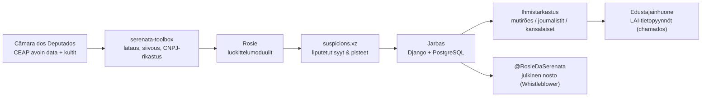

# Operação Serenata de Amor (*Rosie & Jarbas*) – Tutkimusraportti ja sovellettavuus Suomeen

**Tyyppi:** Kansainvälinen esikuvatutkimus (Osa 1/3)  
**Tila:** Faktantarkistettu ja viimeistelty (`14.11.2026`)  
**Aineistoketju:** [`01_suunnitelma_ja_prompt.md`](01_suunnitelma_ja_prompt.md) → [`02_raakadata_ja_tutkimus.md`](02_raakadata_ja_tutkimus.md) → [`03_faktantarkistus.md`](03_faktantarkistus.md) → `README.md`

---

## Tiivistelmä

**Operação Serenata de Amor** on Brasilian tunnetuin kansalaislähtöinen datajournalismi- ja *civic tech* -hanke, joka rakennettiin automatisoimaan liittovaltion kansanedustajien kulukorvausten (*Cota para o Exercício da Atividade Parlamentar – CEAP*) valvontaa.

Lähdekoodiin ja primaariasiakirjoihin perustuva auditointi osoittaa kaksi keskeistä asiaa:
1. **Tekninen todellisuus ilman tekoälyhypeä:** Julkisuudessa **Rosie**-botista puhuttiin usein "tekoälynä", mutta lähdekoodissa se oli ennen kaikkea **hybridi poikkeamaseulontajärjestelmä**: valtaosa ydintarkistuksista oli deterministisiä sääntö- ja rekisteritarkistuksia (hintakatot, verotunnisteiden tarkistussummat, yritysten rekisteritila, mahdottomat matka-ajat), ja ainoa hyvin dokumentoitu koneoppimismalli oli ateriahintojen *k-means*-klusterointi (`MealPriceOutlierClassifier`).
2. **Vaikuttavuussuppilo on tärkeämpi kuin yksittäinen algoritmi:** Hanke seuloi yli **3 miljoonaa** kulukorvausta ja liputti yli **17 700** epäilyä, mutta vasta ihmisten vapaaehtoissprintit (*mutirões*), **Jarbas**-tarkastuskäyttöliittymä ja julkisuuslain mukaiset tietopyynnöt (*chamados*) muuttivat datan hallinnolliseksi paineeksi. Dokumentoitu tosiasiallinen palautus oli **R$ 50 569,18**, ei "miljoonia".

---

## 1. Tausta, rahoitus ja säädöspohja

* **Käynnistyminen ja joukkorahoitus:** Hanke sai alkunsa alkuvuodesta 2016 *Data Science Brigade* -ryhmässä (Irio Musskopf ym.). Ensimmäinen joukkorahoitus ajettiin Catarse-alustalla **7.9.–7.11.2016**, ja se keräsi **R$ 80 424,00** yhteensä **1 296 tukijalta** (131 % alkuperäisestä R$ 61 280,00 tavoitteesta).
* **Institutionalisoituminen:** Vuonna 2018 hanke siirtyi **Open Knowledge Brasil (OKBR)** -järjestön alle osaksi sen *Ciência de Dados para Inovação Cívica* -ohjelmaa. Jatkorahoitus nojasi mm. toistuvaan Apoia.se-joukkorahoitukseen ja infrastruktuurikumppanuuksiin (esim. DigitalOcean).
* **Säädöspohja:**
  * **Ato da Mesa nº 43/2009:** Määrittelee CEAP-kulukorvausten lailliset kategoriat, kuukausikatot ja tilitysvelvoitteet.
  * **Lei de Acesso à Informação (LAI 12.527/2011):** Velvoitti proaktiiviseen avoimeen dataan ja antoi jokaiselle kansalaiselle oikeuden lähettää virallisia selvityspyyntöjä (*chamados*) ilman perusteluvelvollisuutta.
  * **LGPD (13.709/2018):** Vaikka jälkikeskusteluissa on joskus väitetty tietosuojalain poistaneen toimittajien CNPJ/CPF-tunnisteet CEAP-datasta, Brasilian edustajainhuoneen avoimen datan rajapinnat tarjoavat yhä nämä kentät ja skannatut kuittidokumentit.

---

## 2. Datalähde (CEAP), dataputki ja *Jarbas*

Brasilian edustajainhuone (*Câmara dos Deputados*) julkaisee CEAP-tiedot vuodesta 2008 alkaen päivittäin päivittyvinä staattisina XML-, JSON- ja CSV-tiedostoina. Kenttärakenne sisältää mm. edustajan tunnisteen (`ideCadastro`), kululuokan, toimittajan nimen ja **CNPJ/CPF-tunnuksen**, laskun numeron, bruton/neton/hylätyn summan (*glosa*), kuukauden/vuoden sekä matka- ja reittitiedot.

### Arkkitehtuuri ja tietovirta

* **Rikastus ja OCR:** CEAP-dataa rikastettiin Brasilian verohallinnon (*Receita Federal*) CNPJ-yritysrekisteritiedoilla (rekisteröintitila, perustamispäivä, toimialakoodi CNAE) ja paikkatiedoilla (Google Street View). Google Cloud Vision OCR:ää kokeiltiin kuittien tekstintunnistuksessa (`receipt_text` Jarbasissa), mutta Rosien ydinseulonta toimi **rakenteisella CEAP- ja yritysdatalla**, ei kuittikuvien OCR:llä.
* **Jarbas:** Ihmistarkastuksen käyttöliittymä ja API (Django, Gunicorn, PostgreSQL, Celery, RabbitMQ, Elm-käyttöliittymä). Haku toteutettiin suoraan PostgreSQL:n tekstihaulla ilman Elasticsearchia.

---

## 3. *Rosie* lähdekoodin tasolla: mitä se oikeasti teki?

Keskeiset historialliset luokittelumoduulit (`okfn-brasil/serenata-de-amor`):

| Moduuli | Tarkistuksen kohde | Tyyppi | Tekninen toteutus |
| :--- | :--- | :--- | :--- |
| `MonthlySubquotaLimitClassifier` | Ylittävätkö kuukausimenot sallitut CEAP-alakattojen rajat (esim. polttoaine, autonvuokraus) | **Deterministinen sääntö** | Aritmeettinen tarkistus laki-/asetusrajoja vasten |
| `InvalidCnpjCpfClassifier` | Virheellinen toimittajan CNPJ/CPF-verotunnus | **Deterministinen sääntö** | Brasilian tunnusmuodon ja tarkistussumman laskenta |
| `ElectionExpensesClassifier` | Kulun ajoittuminen suhteessa vaalikampanjaan/ehdokkuuteen | **Deterministinen sääntö** | Päivämäärä- ja ehdokasrekisteriliitos |
| `IrregularCompaniesClassifier` | Onko laskun antanut yritys epäaktiivinen, perustettu laskun jälkeen tai toimialaltaan ristiriitainen | **Deterministinen rekisteriristiinajo** | *Receita Federal* -yritysdata |
| `TraveledSpeedsClassifier` | Maantieteellisesti ja ajallisesti mahdottomat peräkkäiset matka-/paikkakuitit | **Sääntö / geospatiaalinen anomalia** | Etäisyys- ja aikavälilaskenta |
| `MealPriceOutlierClassifier` | Poikkeuksellisen kalliit ravintolalaskut suhteessa muuhun jakaumaan | **Tilastollinen / koneoppiminen** | Ohjaamaton **k-means**-klusterointi (`scikit-learn`) |

> **Huomio:** Rosie ei yhdistänyt kaikkia luokittelijoita yhdeksi opituksi "korruptiotodennäköisyydeksi", vaan tuotti luokittelijakohtaisia epäilylippujen syitä ja pisteytyksiä `suspicions.xz`-tiedostoon priorisointia varten.

---

## 4. Vaikuttavuussuppilo ja väärien positiivisten syyt

Faktantarkistuksessa eri vaiheet pidetään tiukasti erillään:

| Vaihe | Määrä | Summa (BRL) | Huomio lähteistä |
| :--- | ---: | ---: | :--- |
| **1. Analysoidut CEAP-kuitit** | > 3 000 000 | *Ei todennettavissa* | OKBR:n 5 vuoden retrospektiivi |
| **2. Rosien liputtamat epäilyt** | > 17 700 *(5 v)* / 8 276 *(varhainen tilannekuva)* | R$ 3,6 milj. *(varhainen tilannekuva)* | Varhainen *Explore*-sivu on päiväämätön |
| **3. Ihmisten tarkastamat** | *(Toissijainen lähde: 849 tammi-2017)* | *Ei todennettavissa* | Vapaaehtoisten *mutirão*-tarkastukset |
| **4. Viralliset kantelut (*chamados*)** | **629 tapausta** (216 edustajaa) | **R$ 378 844,05** | Tammi-2017 raportti; akateeminen lähde mainitsee 587 pyyntöä / 971 kuittia |
| **5. Todistetusti palautetut varat** | **134 edustajaa** *(aikalaisraportti)* / 134 peruutettua korvausta *(OKBR-sivu)* | **R$ 50 569,18** | Yksikköristiriita lähteiden välillä; koski erityisesti ateriamenoja |

### Miksi suppilo kapeni ja mistä väärät positiiviset johtuivat?
* **Hallinnollinen pullonkaula:** Yli **80 %** tietopyynnöistä sai edustajainhuoneelta vakiovastauksen tai siirrettiin yksittäisen edustajan itsensä selitettäväksi ilman automaattista takaisinperintäpakkoa.
* **Väärät positiiviset (expected noise):**
  1. **Ryhmäateriat yhdellä kuitilla:** Iso ravintolalasku näytti tilastollisesti poikkeavalta, vaikka kyse oli seurueesta.
  2. **Kirjausvirheet:** Avustajien näppäilyvirheet laskun tiedoissa.
  3. **Vanhentunut yritysdata:** Paikallinen CNPJ-rekisteri vanheni (mm. GitHub issue #509), jolloin toimiva yritys saattoi liputtua virheellisesti.
  4. **Ajoituserot:** Edustajilla oli jopa 3 kuukautta aikaa toimittaa kuitteja jälkikäteen.
* **`@RosieDaSerenata`-botti:** Julkaisi valikoidusti korkeimman prioriteetin epäilyjä suoralla linkillä Jarbas-kuittiin (tarkoituksena julkinen eskalointi, ei tuomitseminen). Helmikuussa 2019 Twitter rajoitti tilin toimintaa hetkellisesti automaattitilien vastaisessa kampanjassa (`#DesbloqueiaRosie`).

---

## 5. Nykytila (14.11.2026) ja elinkaaren opit

* **Tilanne:** Erillisrepositoriot (`rosie`, `jarbas`, `whistleblower`) arkistoitiin jo vuonna 2018 toiminnallisuuden yhdistämisen jälkeen. Päärepo `okfn-brasil/serenata-de-amor` päivitettiin GitHub-metatietojen mukaan viimeksi **31.1.2024** ja `serenata-toolbox` **8.1.2020**. Pino nojaa vanhoihin riippuvuuksiin (Python 3.5, Node 8), edustajainhuoneen dataformaattimuutokset rikkoivat putkia ja Google Maps/Street View -API muuttui maksulliseksi.
* **Perintö:** OKBR siirsi kehityspainopisteen **Querido Diário** -hankkeeseen (kuntien virallisten lehtien louhinta). Keskeisin oppi ei ole yksittäinen algoritmi, vaan **koko ketjun suunnittelu**: pelkkä poikkeamantunnistus ei muuta hallintoa, jos datan ylläpito jää vapaaehtoisten käsin päivitettäväksi eikä kytkeydy kestävään journalistiseen tai institutionaaliseen prosessiin.

---

## 6. Oikeudellis-tekninen sovellettavuus Suomeen

Miten *Serenata de Amor* -malli toimii Suomessa — ja missä kohtaa suomalainen lainsäädäntö ja dataympäristö pakottavat tekemään asiat täysin eri tavalla?

### 6.1. Datalähteen ero: CEAP-kuitit vs. Suomen ostolaskut ja pöytäkirjat
* **Mikä Suomessa puuttuu:** Suomessa eduskunta tai kunnat eivät julkaise kansanedustajien tai luottamushenkilöiden yksittäisiä ravintola- ja taksikuitteja päivittäin päivittyvänä avoimena datana kuvineen.
* **Mikä Suomessa on vahvempaa:** Suomessa on maailmanluokan rakenteinen **yritys- ja hankintadata** (YTJ/PRH, Hilma, Handi / Tutkihankintoja.fi, kuntien ostolaskudata `Avoindata.fi`:ssä) sekä julkiset **päätöspöytäkirjat** (Dynasty, Ahjo, Tweb).
* **Johtopäätös:** Suomessa "Rosie"-tyyppinen seulonta ei kohdistu yksittäisiin ateria- tai taksikuitteihin, vaan **ostolaskujen, hankintarajojen, esteellisyyksien ja kaksoisroolien ristiinajoon**: *Ostaako kunta tai hyvinvointialue suorahankintana valtuutetun tai hänen lähipiirinsä yritykseltä? Alitetaanko kilpailutusrajoja pilkkomalla laskuja?*

### 6.2. Julkisuuslaki (621/1999) ja tietopyynnöt
* Suomen **Julkisuuslaki (621/1999)** vastaa periaatteeltaan Brasilian LAI-lakia: kuka tahansa voi pyytää viranomaisen julkista asiakirjaa (esim. ostolaskuja, matkalaskuja tai sopimuksia) ilman perusteluvelvollisuutta.
* **Ero:** Kun *Serenata* lähetti joukkotietopyyntöjä automatisoidun Jarbas-linkin kautta, Suomessa on vältettävä viranomaisten tukkimista massapyynnöillä ja kohdistettava tietopyynnöt (JulkL 13 §) vain ihmisen esitarkastamiin poikkeamiin.

### 6.3. GDPR, Tietosuojalaki (1050/2018) ja rikoslaki (RL 24:8 & 24:9) – Miksi `@RosieDaSerenata`-botti EI kelpaa Suomeen
Suomessa automaattinen Twitter/X-botti, joka tägää yksittäisen poliitikon tai viranhaltijan ja väittää tai vihjaa kuittia "epäilyttäväksi" ilman journalistista tarkistusta, olisi **erittäin korkean juridisen riskin toimintaa**:

1. **Kunnianloukkaus (RL 24:9) ja yksityiselämää loukkaavan tiedon levittäminen (RL 24:8):** Jos algoritmin väärä positiivinen (esim. ryhmäateria tai kirjausvirhe) julkaistaan automaattisesti nimellä varustettuna vihjauksena väärinkäytöksestä, julkaisija ei voi piiloutua "botin tekemän" tilastopoikkeaman taakse.
2. **Tietosuojalaki (1050/2018) 27 § (Journalistinen poikkeus) & GDPR:** Laajamittainen luonnollisten henkilöiden poikkeamarekisterin julkaiseminen avoimessa verkossa (kuten Jarbas) edellyttää joko tiukkaa journalistista toimituksellista tarkoitusta tai **tietosuojan minimointia**.
3. **Suomalainen turvallinen arkkitehtuuri (Zero-Name / Human-in-the-Loop):**
   * **Suorita ensisijaiset ristiinajot oikeushenkilöillä (`Y-tunnus`)**, joilla ei ole GDPR-henkilötietosuojaa (Hilma ⟷ Ostolaskut ⟷ PRH).
   * **Säilytä sisäisissä työkaluissa asiakirjakoordinaatit** (`kuntakoodi`, `diaarinumero`, `pykälä`, `source_url`), älä pysyviä henkilörekistereitä epäillyistä.
   * **Pidä ihminen aina julkaisukynnyksen vartijana:** Koodi seuloo ja priorisoi, tutkiva toimittaja tarkistaa alkuperäiset asiakirjat, kuulee asianosaisia hyvän journalistisen tavan (JO) mukaisesti ja vasta sen jälkeen päättää julkaisusta.
